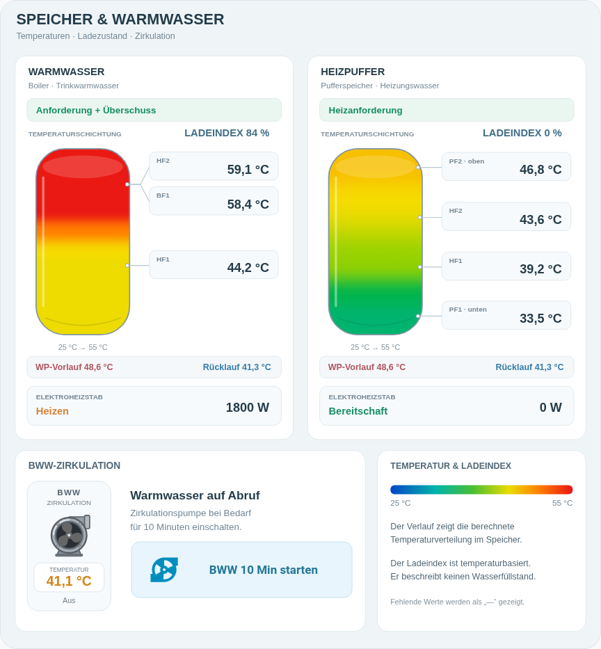

# Boiler, Pufferspeicher und Zirkulation

Speicher- und Heizkreistemperaturen, Elektroheizstäbe und Warmwasserzirkulation. Die Karte erscheint in HACS als **Dashboard**.



## Voraussetzungen

- **Button Card** für die Darstellung und Bedienung, geprüft mit Version 7.0.1. [custom-cards/button-card](https://github.com/custom-cards/button-card)

Die Karte verwendet bereits vorhandene Home-Assistant-Entitäten. Übersicht und Messwerte werden im Dashboard angezeigt, sobald die Entitäten zugeordnet sind.

## Über HACS installieren

1. Suche in HACS nach **Boiler, Pufferspeicher und Zirkulation**. Falls die Karte noch nicht angezeigt wird, öffne **HACS → ⋮ → Benutzerdefinierte Repositorys**, füge `https://github.com/marcofeurer/boiler-puffer-dashboard-card` hinzu und wähle die Kategorie **Dashboard**.
2. Öffne die Karte in HACS und wähle **Herunterladen**. Lade das Dashboard anschließend neu.
3. Öffne **Dashboard bearbeiten → Karte hinzufügen** und wähle **Boiler, Pufferspeicher und Zirkulation**.

## Entitäten visuell zuordnen

Öffne **Dashboard bearbeiten → Karte bearbeiten**. Im visuellen Editor findest du die Entitäten in vier Gruppen.

- **Boiler** und **Pufferspeicher** enthalten jeweils Heizanforderung, Überschussbetrieb, Heizstab-Status, Heizstab-Leistung und die Temperaturfühler.
- **Heizung** enthält Wärmepumpen-Vorlauf und -Rücklauf sowie die Vorlauf-Solltemperatur des Heizkreises.
- **Warmwasserzirkulation** enthält Rücklauftemperatur, Pumpenrelais und Startskript.

Suche in den Feldern nach einer vorhandenen Entität. Der Editor zeigt bereits gespeicherte Zuordnungen an. Wenn du eines der Zuordnungsfelder leerst, verwendet die Karte dort wieder ihre Platzhalter-ID. Die Konfiguration lässt sich auch im YAML-Editor bearbeiten. [Beispielkonfiguration](example.yaml)

Die Schaltfläche für die Warmwasserzirkulation ruft das unter `zirkulation.startskript` zugeordnete `script.*` auf. `zirkulation.pumpe_relais` liefert den Pumpenstatus. Lege das Skript in Home Assistant an oder verwende ein bestehendes Skript, das die Pumpe wie gewünscht steuert.

## Temperaturfühler verwalten

Klappe unter **Boiler** oder **Pufferspeicher** den Bereich **Speicherhöhe und Temperaturfühler** auf. Über **Fühler hinzufügen** wählst du eine vorhandene Temperatur-Entität und gibst ihre Höhe und optional einen Anzeigenamen ein. **Entfernen** nimmt den Fühler aus der Karte. Du kannst Entität, Namen und Höhe jederzeit direkt im Editor ändern.

Miss die Höhe in Millimetern ab Speicherboden. **0 mm** liegt unten, die eingetragene Speicherhöhe liegt ganz oben. Beim Pufferspeicher dient **1000 mm** zunächst als Bezugsgrösse für die bisherigen relativen Positionen. Gib zuerst die tatsächliche Innenhöhe ein und passe dann die Fühler an.

Im YAML-Editor kannst du die gleichen Einstellungen festlegen. Jede Fühlerliste enthält alle Fühler des jeweiligen Speichers. Eine leere Liste `[]` blendet sie alle aus. Fehlt die Liste, übernimmt die Karte die bisherige Konfiguration.

```yaml
boiler_hoehen:
  speicher_mm: 1410
boiler_fuehler:
  - entitaet: sensor.beispiel_boiler_temperatur_hf2
    name: Oben
    hoehe_mm: 1140
  - entitaet: sensor.beispiel_boiler_temperatur_hf1
    name: Unten
    hoehe_mm: 525
```

Für den Pufferspeicher heissen die entsprechenden Einstellungen `puffer_hoehen` und `puffer_fuehler`. Die Karte verwendet die eingestellten Positionen für Markierungen, Temperaturschichtung und Ladeindex. Sind mehrere Fühler auf derselben Höhe, mittelt sie die verfügbaren Messwerte. Bei einem einzelnen Messwert zeigt sie eine einheitliche Farbe. Der Ladeindex benötigt mindestens zwei belegte Höhen. Beim Pufferspeicher benötigt er zusätzlich die Vorlauf-Solltemperatur.

## Fehlersuche

Wenn Home Assistant meldet, dass der Kartentyp fehlt, lade die Seite neu und prüfe unter **Einstellungen → Dashboards → ⋮ → Ressourcen**, ob `/hacsfiles/boiler-puffer-dashboard-card/boiler-puffer-dashboard-card.js` als **JavaScript-Modul** eingetragen ist. Bei YAML-verwalteten Dashboard-Ressourcen ergänze die URL in deiner YAML-Ressourcenliste.

[HACS-Dokumentation für Dashboard-Repositorys](https://www.hacs.xyz/docs/publish/plugin/) · [Benutzerdefinierte Repositorys](https://www.hacs.xyz/docs/faq/custom_repositories/)

## Lizenz

Die Karte steht unter der [MIT-Lizenz](LICENSE).
